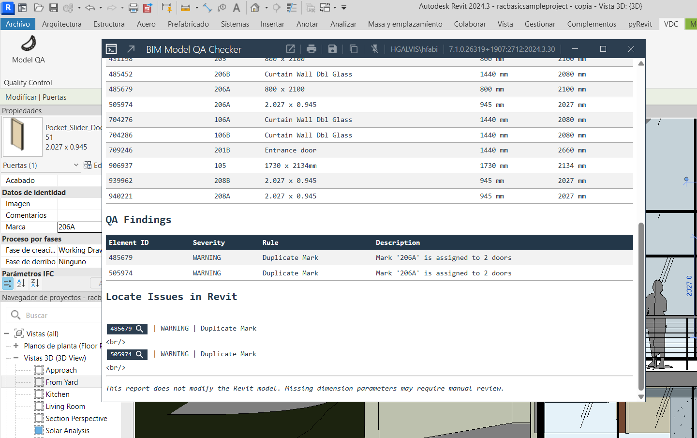
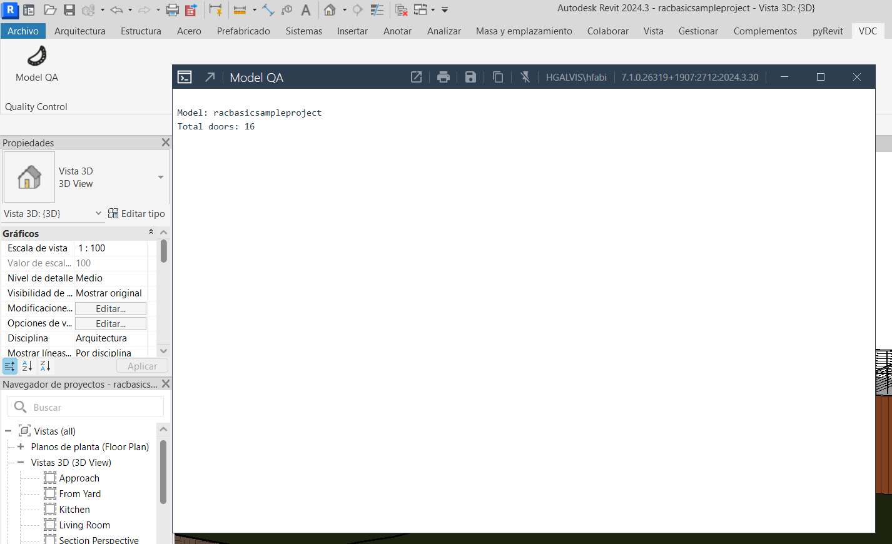
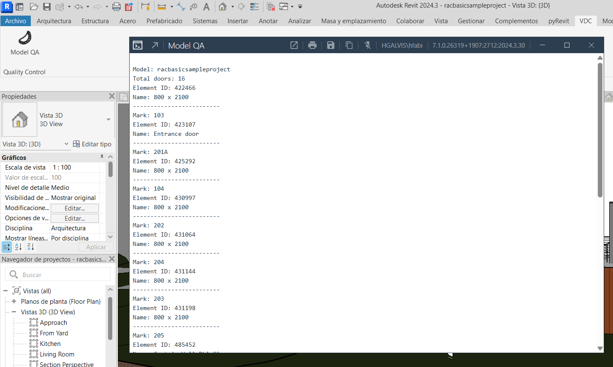
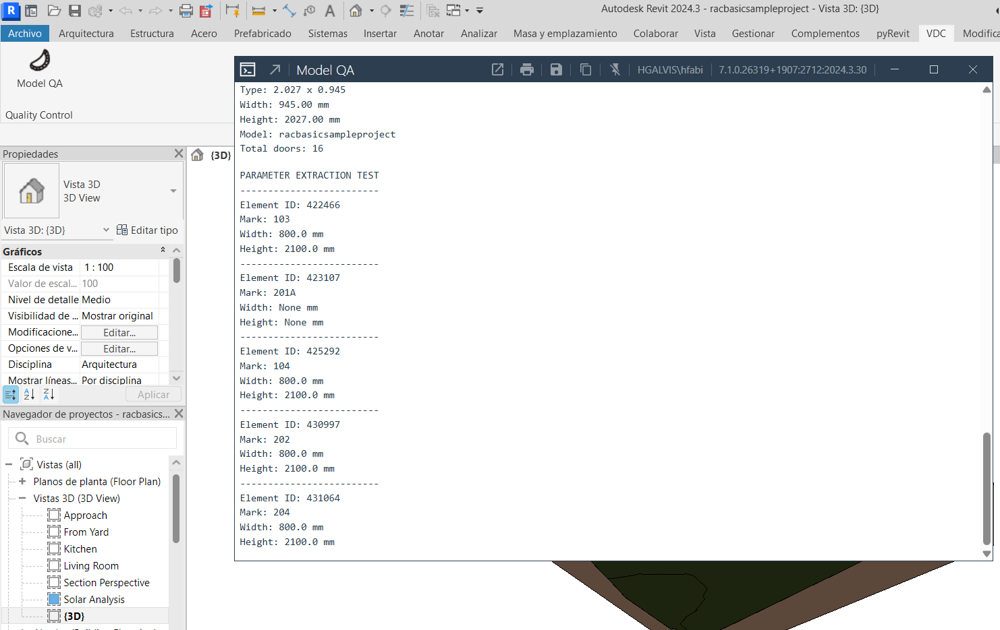
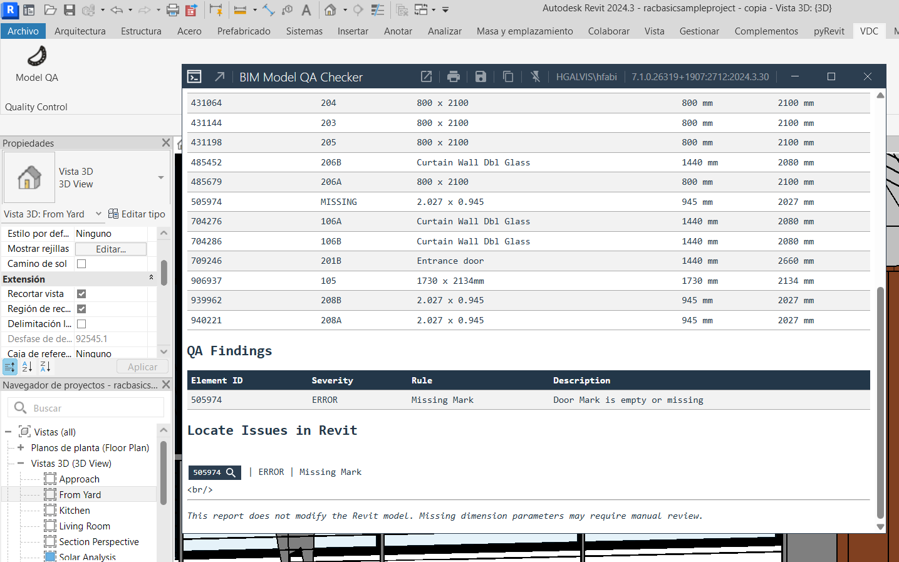
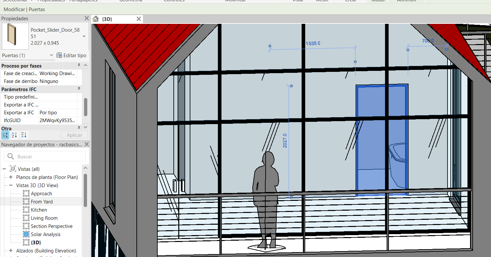

# BIM Model QA Checker

**Automated Door Quality Assurance using Python, pyRevit, and the Autodesk Revit API**



## Overview

BIM Model QA Checker is a custom pyRevit extension that automates basic quality assurance checks on door elements in Autodesk Revit.

The application collects door instances, extracts BIM parameters, applies validation rules, and generates an interactive report directly inside Revit.

It was developed as a hands-on BIM automation project to demonstrate practical knowledge of Python, the Revit API, BIM data structures, and software development workflows.

| Property | Details |
|---|---|
| Software | Autodesk Revit 2024.3 |
| Framework | pyRevit 7.1 |
| Language | Python / IronPython |
| API | Autodesk Revit API |
| Project Type | BIM Automation / QA/QC |
| Status | Functional prototype |

## 1. Problem Statement

BIM models contain structured information that supports coordination, documentation, scheduling, and construction management.

However, inconsistent or incomplete parameters can reduce model reliability and increase the time required for quality assurance.

This project addresses several common data quality concerns:

- Missing door identification marks.
- Duplicate identification marks.
- Unavailable dimensional parameter values.
- Invalid dimensional values.

The tool provides an automated initial review to help identify elements requiring additional attention.

## 2. Main Features

### Automated Door Collection

Uses `FilteredElementCollector` to retrieve door instances from the active Revit document.

### Parameter Extraction

Extracts the following data:

| Parameter | Source |
|---|---|
| Element ID | Revit element |
| Type ID | Revit element |
| Mark | Instance parameter |
| Type Name | Type parameter |
| Width | Type parameter, with instance fallback |
| Height | Type parameter, with instance fallback |

Revit internal length units are converted into millimeters through `UnitUtils.ConvertFromInternalUnits()`.

### Quality Assurance Rules

| Rule | Severity | Validation |
|---|---|---|
| Missing Mark | ERROR | Mark is empty, missing, or contains only whitespace |
| Duplicate Mark | WARNING | Multiple doors share the same normalized Mark |
| Missing Dimensions | REVIEW | Width or Height cannot be retrieved through the queried parameters |
| Invalid Dimensions | ERROR | Width or Height is zero or negative |

Duplicate Marks are reported as warnings because identification requirements may vary between projects.

Missing Dimensions are classified as REVIEW because some families may store their dimensions through alternative parameters or geometric relationships.

### Interactive Reporting

The tool generates a pyRevit output report containing:

- Door inventory.
- Quality summary.
- Error, warning, and review counts.
- QA findings table.
- Clickable Revit element references.

The application does not modify the Revit document.

## 3. Technical Architecture

```text
Revit Document
      |
      v
collect_doors()
      |
      v
extract_door_data()
      |
      v
validate_doors()
      |
      v
generate_report()
      |
      v
Interactive pyRevit Report
```

### Main Functions

| Function | Responsibility |
|---|---|
| `collect_doors()` | Retrieves door instances from the active model |
| `get_string_parameter()` | Safely reads string parameters |
| `get_dimension_mm()` | Retrieves and converts length parameters |
| `extract_door_data()` | Creates a structured dictionary for each door |
| `validate_doors()` | Applies four BIM quality rules |
| `format_dimension()` | Formats numerical dimensions |
| `get_severity_counts()` | Aggregates findings by severity |
| `generate_report()` | Creates tables and clickable element links |
| `main()` | Coordinates the complete workflow |

### Revit API Concepts

**FilteredElementCollector**

Retrieves elements by category and excludes element type definitions when collecting placed door instances.

**Instance and Type Parameters**

Retrieves Mark from the door instance, while dimensional values are initially requested from the associated door type, with an instance-level fallback.

**ElementId and GetElement()**

Allow navigation between a placed door and its corresponding type definition.

**StorageType**

Ensures parameters are read using the appropriate method, such as `AsString()` or `AsDouble()`.

**UnitUtils**

Converts Revit internal length values into millimeters.

**pyRevit Output**

Uses `script.get_output()`, `print_md()`, `print_table()`, and `linkify()` to generate the interactive report.

## 4. Source Code Structure

```text
01-bim-model-qa/
|
|-- src/
|   |-- VDCTools.extension/
|       |-- VDC.tab/
|           |-- Quality Control.panel/
|               |-- Model QA.pushbutton/
|                   |-- script.py
|                   |-- icon.png
|
|-- screenshots/
|-- sample-model/
|-- README.md
```

[View Python Source Code](src/VDCTools.extension/VDC.tab/Quality%20Control.panel/Model%20QA.pushbutton/script.py)

## 5. Installation

### Requirements

- Autodesk Revit 2024.
- pyRevit installed and attached to Revit.
- Windows.
- A Revit architectural model containing doors.

### Setup

1. Clone or download the repository.
2. Open Autodesk Revit.
3. Navigate to the pyRevit settings.
4. Add `01-bim-model-qa/src` as a Custom Extension Directory.
5. Save the configuration and reload pyRevit.
6. Open an architectural Revit model.
7. Select **VDC → Quality Control → Model QA**.

The tool analyzes the active document and displays the results inside Revit.

## 6. Testing and Results

Development and testing were performed using an Autodesk architectural sample project in Revit 2024.3.

### Model Analysis

| Metric | Result |
|---|---:|
| Door Instances | 16 |
| Available Door Types | 5 |
| Used Door Types | 5 |

### Test 1 — Door Collection

The tool successfully collected 16 door instances using `FilteredElementCollector`.



### Test 2 — Parameter Extraction

The application successfully extracted identification marks, type information, and available dimensions.



### Test 3 — Structured Data Extraction

Door parameters were organized into Python dictionaries, separating data extraction from validation and reporting.



### Test 4 — Missing Mark Validation

A door Mark was temporarily cleared in a separate test model.

**Result:** The application successfully generated an ERROR finding identifying the affected door.



### Test 5 — Duplicate Mark Validation

Two door instances were temporarily assigned the same Mark value: `206A`.

**Result:** The application generated two Duplicate Mark warnings for the affected instances.


### Test 6 — Element Navigation

Interactive references were generated using pyRevit's `linkify()` method to support locating the affected elements.



### Validation Coverage

Missing Mark and Duplicate Mark were verified through controlled changes to a Revit test model.

Dimension extraction was also exercised across several door types.

Additional controlled tests are still required for the Invalid Dimensions rule and for broader validation of missing dimensional parameters.

## 7. Engineering Decisions

### Separation of Concerns

The code separates data collection, parameter extraction, validation, and report generation into reusable functions.

This makes the application easier to maintain and extend.

### Read-Only Processing

The QA Checker does not create Revit transactions because it only reads model information.

### Defensive Parameter Access

Parameter existence, value availability, and storage type are checked before attempting to read data.

### Handling Missing Information

Unavailable dimensional parameters generate REVIEW findings rather than automatically being classified as defective geometry.

### IronPython Compatibility

The script uses `.format()` for string formatting and retrieves type names through built-in parameters to avoid interoperability problems encountered during development.

## 8. Known Limitations

- Only door elements are currently analyzed.
- Duplicate Mark detection does not account for levels, phases, or project-specific naming conventions.
- Some families may use custom parameters or geometry-based dimensions.
- A missing parameter value does not necessarily indicate missing geometry.
- Reports are displayed within pyRevit and are not yet exported to CSV or Excel.
- Not all validation rules have undergone controlled model-based testing.
- The prototype has been tested in Revit 2024.3; compatibility with other versions has not been fully verified.

## 9. Future Improvements

Planned opportunities for further development include:

- Configurable QA rules.
- Additional categories such as Windows, Rooms, and Walls.
- Expanded support for custom parameters.
- Automated unit testing.
- CSV and Excel export.
- Model quality dashboards.
- Integration with other BIM coordination workflows.

## 10. Skills Demonstrated

- Python scripting and reusable functions.
- Autodesk Revit API programming.
- pyRevit extension development.
- BIM instance and type parameter handling.
- Unit conversion.
- Structured data extraction and validation.
- Python dictionaries and collections.
- Debugging and error handling.
- Git version control.
- BIM QA/QC reporting.

## References

- [Revit API 2024 Documentation](https://www.revitapidocs.com/2024/)
- [Autodesk Revit API Developer Guide](https://help.autodesk.com/cloudhelp/2024/ENU/Revit-API/files/Revit_API_Developers_Guide/Revit_API_Revit_API_Developers_Guide_html.html)
- [pyRevit Documentation](https://docs.pyrevitlabs.io/)
- [pyRevit GitHub](https://github.com/pyrevitlabs/pyRevit)
- [Autodesk Sample Models](https://help.autodesk.com/cloudhelp/2024/ENU/Revit-GetStarted/files/GUID-61EF2F22-3A1F-4317-B925-1E85F138BE88.htm)

---

**BIM Automation Portfolio — Project 01**

*Automating BIM data quality checks through Python and the Autodesk Revit API.*
