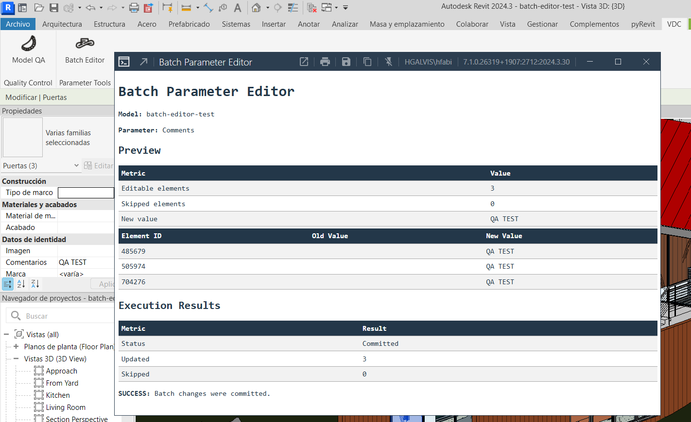

# Batch Parameter Editor

**Project 02 — BIM Automation Portfolio**

A Python-based pyRevit automation tool designed to safely edit instance text parameters across selected Autodesk Revit elements.

The project demonstrates Revit API integration, automatic parameter discovery, data validation, transaction management, and controlled BIM model modifications.

## 1. Project Overview

The Batch Parameter Editor addresses a common BIM workflow: updating parameter values across multiple model elements without manually editing each instance.

The tool allows users to select Revit elements, discover compatible parameters, review proposed changes, and execute batch updates using the Autodesk Revit API.

The primary objective is to demonstrate how Python and pyRevit can automate repetitive BIM data management tasks while maintaining control over model modifications.

## 2. Technology Stack

| Technology | Purpose |
|---|---|
| Autodesk Revit 2024.3 | BIM authoring environment |
| Revit API | Access and modify model elements and parameters |
| pyRevit 7.1 | Revit interface integration and Python execution |
| IronPython | Python scripting environment |
| Visual Studio Code | Development environment |
| Git & GitHub | Version control and documentation |

## 3. Features

### 3.1 Element Selection

The tool retrieves elements from the active Revit selection using:

- `UIDocument.Selection.GetElementIds()`
- `Document.GetElement()`

Only the selected elements are considered for modification.

### 3.2 Automatic Parameter Discovery

The editor automatically inspects selected elements to discover compatible instance text parameters.

The discovery workflow:

1. Reads parameters from the selected element instances.
2. Filters parameters by `DB.StorageType.String`.
3. Excludes read-only parameters.
4. Identifies supported document-defined parameters.
5. Finds parameters common to eligible selected instances.
6. Generates the parameter selection interface dynamically.

This reduces the need to manually configure parameter names in the Python script.

### 3.3 Built-in Parameter Support

The editor includes dedicated handling for:

**Comments**

- Supports batch editing.
- Uses `ALL_MODEL_INSTANCE_COMMENTS`.
- Allows the same text value to be applied to multiple eligible instances.

**Mark**

- Supports single-element editing.
- Uses `ALL_MODEL_MARK`.
- Restricts editing to one selected element per operation to reduce accidental duplicate identifiers.

Mark uniqueness is not checked across the entire model.

### 3.4 Parameter Validation

Before modifying the model, the tool validates:

- Element instance eligibility.
- Group membership.
- Parameter existence.
- Parameter identity.
- Parameter storage type.
- Read-only status.
- Existing values.

Elements that fail validation are excluded from the modification batch.

### 3.5 Change Preview

Before executing changes, the tool displays:

- Active model name.
- Selected parameter.
- Number of editable elements.
- Number of skipped elements.
- Current parameter values.
- Proposed new values.
- Reasons for skipped elements.

The user must confirm the proposed operation before any changes are committed.

### 3.6 Transaction Management

The tool performs permitted modifications inside a single `DB.Transaction`.

The workflow uses:

- `Transaction.Start()`
- `Parameter.Set()`
- `Transaction.Commit()`
- `Transaction.RollBack()`

The implementation checks transaction status and attempts rollback when an exception occurs during the modification process.

If the transaction outcome cannot be verified, the tool reports an explicit warning.

### 3.7 Execution Report

After execution, the tool displays:

- Transaction status.
- Number of updated elements.
- Number of skipped elements.
- Errors or warnings.

## 4. Project Structure

```text
02-batch-parameter-editor/
│
├── README.md
│
├── screenshots/
│   └── 01-successful-batch-update.png
│
├── sample-models/
│   └── batch-editor-test.rvt
│
└── src/
    └── BatchParameterTools.extension/
        └── VDC.tab/
            └── Parameter Tools.panel/
                ├── Batch Editor.pushbutton/
                │   ├── icon.png
                │   └── script.py
                │
                └── Rollback Test.pushbutton/
                    └── script.py
```

The sample model is stored locally and excluded from Git version control.

The Rollback Test button is a separate development and testing utility and is not required for normal batch editing.

## 5. Installation

### Requirements

- Autodesk Revit 2024
- Compatible pyRevit installation
- Python scripting engine supported by pyRevit

### Setup

1. Clone or download the repository.
2. Locate `02-batch-parameter-editor/src/`.
3. Register that directory as a pyRevit extension search path.
4. Reload pyRevit.
5. Open the **VDC** tab in Revit.
6. Locate **Parameter Tools → Batch Editor**.

The extension is named `BatchParameterTools.extension` and can be loaded independently of the other portfolio projects.

## 6. How to Use

1. Open an editable Revit project.
2. Select one or more model elements.
3. Launch **VDC → Parameter Tools → Batch Editor**.
4. Select a parameter from the automatically generated list.
5. Enter a new text value.
6. Review the proposed changes.
7. Confirm the operation.
8. Review the execution report.
9. Verify the updated parameter values in Revit Properties.

Use a disposable test model when evaluating unfamiliar parameter configurations.

## 7. Development Milestones

### Milestone 01 — Basic Batch Parameter Editing

**Objective:** Build a working tool capable of editing the instance Comments parameter across multiple selected elements.

Implemented:

- Element selection.
- Comments parameter access.
- Parameter validation.
- Change preview.
- User confirmation.
- Transaction-based modification.
- Execution report.

**Verified Test Results**

| Test | Result |
|---|---|
| Model | Autodesk architectural sample copy |
| Selected elements | 3 door instances |
| Parameter | Comments |
| New value | QA TEST |
| Updated elements | 3 |
| Skipped elements | 0 |
| Transaction | Committed |
| Property verification | Passed |

The updated value was confirmed in the Revit Properties interface.

### Milestone 02 — Controlled Transaction Rollback

**Objective:** Demonstrate how transaction rollback can prevent partial changes from being committed after an execution failure.

A separate test command was developed to:

1. Read the original Comments value.
2. Start a transaction.
3. Temporarily change the parameter.
4. Simulate an exception.
5. Attempt transaction rollback.
6. Compare the final value with the original value.

The controlled rollback test implementation is available for development purposes.

**Validation status:** A complete recorded test result has not yet been included in this documentation.

### Milestone 03 — Enhanced Parameter Selection

**Objective:** Extend the editor beyond a single hardcoded parameter.

Implemented:

- Parameter selection interface.
- Built-in Comments editing.
- Single-element Mark editing.
- Custom text parameter selection.
- Improved parameter validation.
- Transaction outcome reporting.

The enhanced selection interface was launched and exercised locally in Revit.

### Milestone 04 — Automatic Parameter Discovery

**Objective:** Automatically identify compatible text parameters from the active selection.

Implemented:

- Dynamic inspection of instance parameters.
- Filtering by storage type and editability.
- Identification of supported document-defined parameters.
- Parameter intersection across eligible selected instances.
- Dynamic pyRevit parameter selection.
- Dedicated handling for Comments and Mark.
- Preservation of preview, confirmation, and transaction safeguards.

**Observed Test**

The automatic parameter selection interface loaded successfully with two selected door instances.

The interface displayed:

`Comments [Built-in | Batch]`

This was consistent with the current restrictions because Mark is limited to single-element selection and no additional compatible shared parameter was observed.

**Validation status:** Automatic parameter discovery interface verified. A full write test using an automatically discovered custom parameter has not been performed.

## 8. Screenshots

### Milestone 01 — Successful Batch Update



Additional testing screenshots may be added as new cases are independently verified.

## 9. Important Revit API Concepts

| API Component | Purpose |
|---|---|
| `UIDocument` | Access the active Revit user interface and selection |
| `Document` | Access the active model |
| `ElementId` | Identify model elements |
| `Document.GetElement()` | Retrieve elements from the document |
| `Element.Parameters` | Inspect element parameters |
| `Parameter` | Access and modify a parameter |
| `BuiltInParameter` | Identify built-in Revit parameters |
| `ParameterElement` | Identify document-defined parameter elements |
| `StorageType` | Determine how parameter values are stored |
| `Parameter.IsReadOnly` | Check whether a parameter permits editing |
| `Parameter.Set()` | Request a parameter value modification |
| `DB.Transaction` | Manage model modification operations |
| `Transaction.RollBack()` | Revert a transaction when applicable |

## 10. Limitations and Safety Considerations

- Supports instance text parameters only.
- Numeric and unit-based parameters are not supported.
- Automatic discovery is limited to compatible document-defined parameters.
- Certain built-in parameters are intentionally excluded from automatic discovery.
- Mark editing is restricted to one element but does not guarantee uniqueness.
- Grouped elements and element types are excluded.
- Empty replacement values are not supported.
- Parameters must pass validation before editing.
- Workshared and linked model scenarios have not been fully validated.
- Transaction commit status does not replace independent verification of model data.
- The tool is intended for controlled testing and educational portfolio use until broader validation is completed.

## 11. Development Methodology

The project followed an iterative development process:

**Build → Test → Commit → Document → Learn**

Development began with a narrow, functional MVP and expanded through separate milestones.

Each significant improvement was tracked through Git commits, allowing earlier implementations to be recovered and reviewed.

The project prioritizes functional Revit automation, safe parameter handling, and reproducible technical documentation.

## 12. Future Improvements

Potential improvements outside the current project scope include:

- Advanced parameter discovery using shared parameter GUIDs.
- Numeric parameter editing with unit conversion.
- Model-wide Mark uniqueness validation.
- CSV-based parameter mapping and batch updates.
- More extensive worksharing validation.
- Automated regression testing.

These features are not part of the current implementation.

## 13. Project Status

**Functional prototype — automatic parameter discovery implemented and interface tested in Revit 2024.3.**

Core batch editing was successfully verified. Advanced parameter discovery and transaction safety cases require additional validation before production use.

## Portfolio

[Back to BIM Automation Portfolio](https://github.com/hgalvis97/BIM_AUTOMATION_PORTFOLIO)