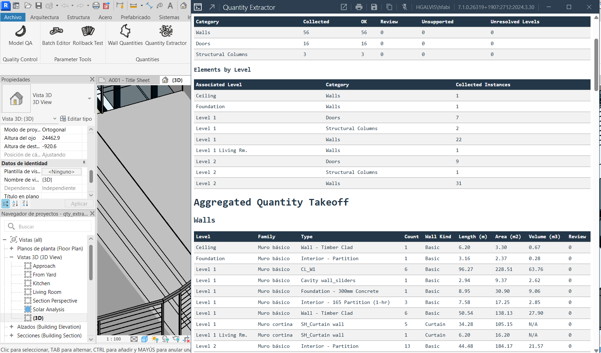
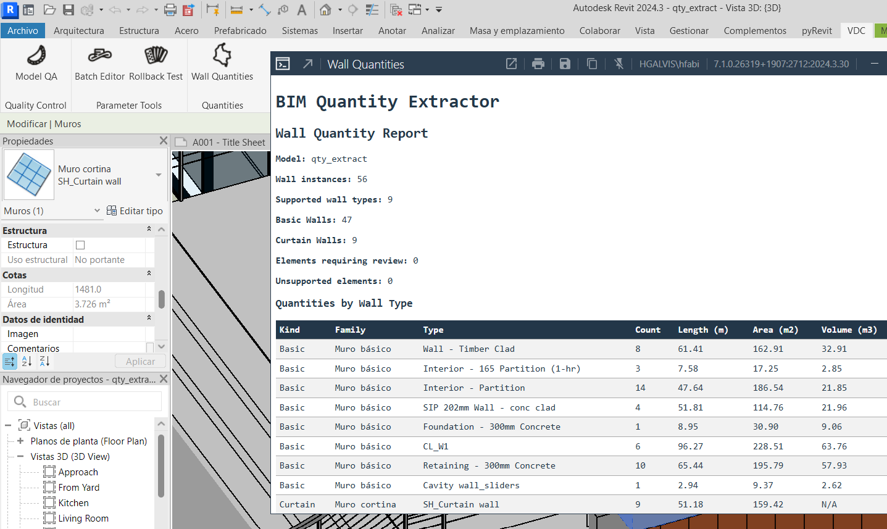
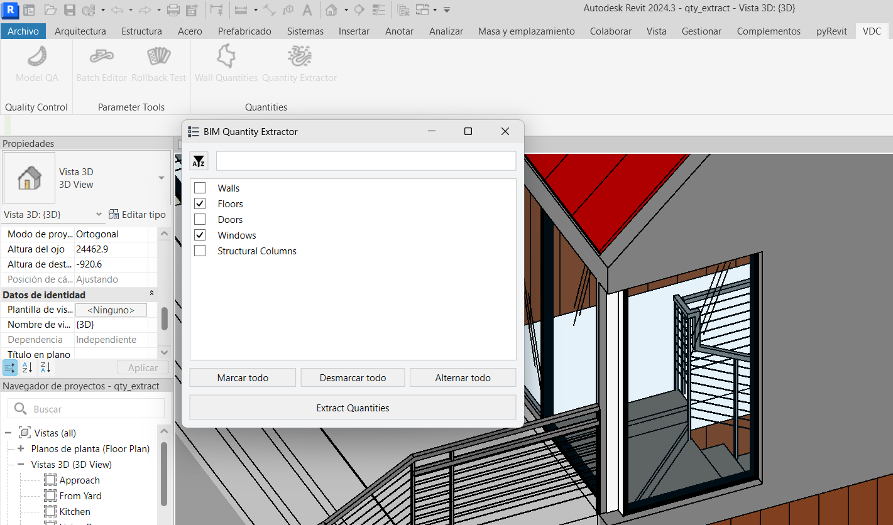
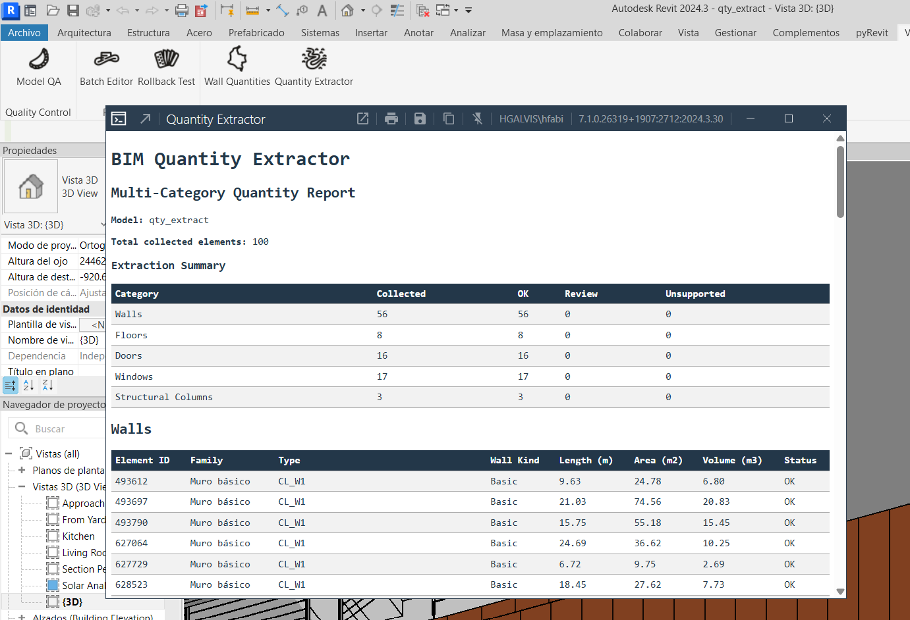
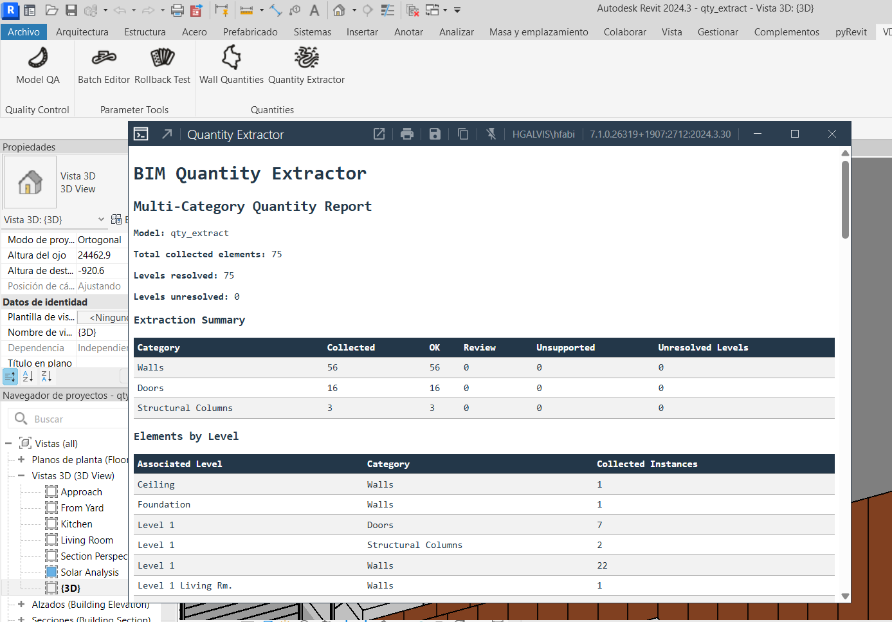
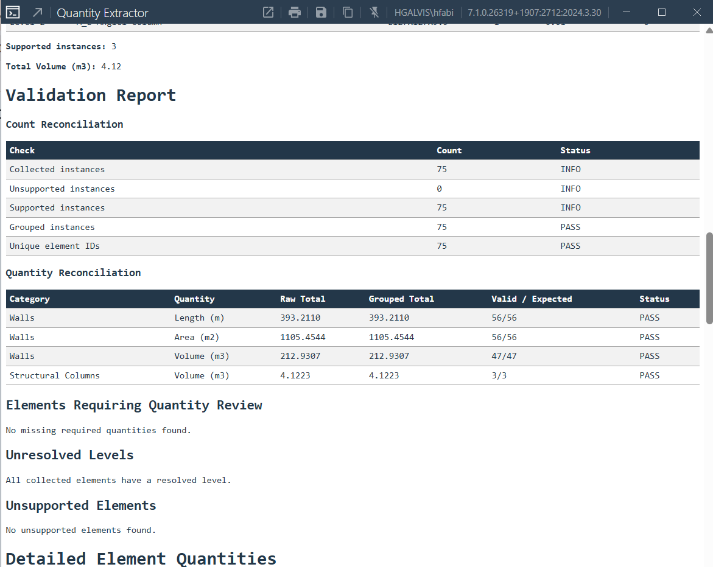
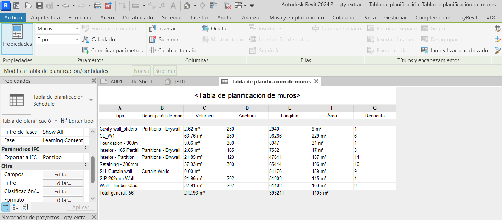

# BIM Quantity Extractor

**Project 03 — BIM Automation Portfolio**

A Python-based pyRevit automation tool designed to extract,
validate, aggregate, and export Building Information Modeling
(BIM) quantities from Autodesk Revit.

The project demonstrates Revit API integration, configurable
data extraction, quantity takeoff, data reconciliation,
modular programming, and structured CSV datasets for
downstream analytics.

**Status: Functional prototype — Tested in Revit 2024.3**



---

## 1. Project Overview

The BIM Quantity Extractor addresses a common construction
and VDC workflow: transforming BIM model information into
structured and measurable quantities that can be used for
estimating, planning, reporting, and data analysis.

The tool allows users to select multiple Revit categories,
extract relevant physical quantities, identify associated
levels, consolidate information, and export validated
datasets.

The primary objective is to demonstrate how BIM automation
can connect model authoring environments with external
data analysis workflows.

The tool operates in read-only mode and does not modify
the Revit model.

## 2. Technology Stack

| Technology | Purpose |
|---|---|
| Autodesk Revit 2024.3 | BIM authoring and testing environment |
| Autodesk Revit API | Model and parameter access |
| pyRevit 7.1 | Custom Revit interface integration |
| IronPython | Automation scripting |
| Python Standard Library | Data processing and CSV export |
| Visual Studio Code | Development environment |
| Git & GitHub | Version control and documentation |
| CSV | Structured data exchange |

No external Python packages are required.

## 3. Available Tools

The extension provides two commands within the VDC tab.

### Wall Quantities

A specialized quantity extraction tool for walls.

Features include:

- Wall instance collection.
- Basic and Curtain Wall classification.
- Length, area, and volume extraction.
- Quantity validation by wall kind.
- Aggregation by wall type.
- CSV export.



### Quantity Extractor

A configurable multi-category extraction tool.

Features include:

- Multiple category selection.
- Generic element collection.
- Category-specific quantity extraction.
- Associated level identification.
- Quantity aggregation.
- Internal data reconciliation.
- Modular CSV export.


## 4. Supported Categories and Quantities

| Category | Count | Length | Area | Volume | Width | Height |
|---|---|---|---|---|---|---|
| Walls | Yes | m | m² | m³* | — | — |
| Floors | Yes | — | m² | m³ | — | — |
| Doors | Yes | — | — | — | mm | mm |
| Windows | Yes | — | — | — | mm | mm |
| Structural Columns | Yes | — | — | m³ | — | — |

*Volume is extracted for supported Basic Walls.
Curtain Wall volume is outside the current extraction scope.

All categories include element identity, family, type,
and associated level information when available.

Quantities are retrieved from Revit parameters rather than
estimated through simplified geometric calculations.

## 5. Core Features

### 5.1 Multi-Category Selection

The user selects one or more supported categories through
a native pyRevit selection interface.

The interface uses:

`forms.SelectFromList.show(multiselect=True)`

Only the selected categories are processed.



### 5.2 Configuration-Driven Extraction

The extraction engine uses centralized dictionaries to
define:

- Supported Revit categories.
- Required quantity parameters.
- Measurement units.
- Aggregation methods.
- Level resolution rules.

The configuration-driven approach reduces duplicated code
and makes it easier to introduce additional categories.

### 5.3 Physical Quantity Extraction

The tool retrieves physical quantities using built-in
Revit parameters.

The extraction process validates parameter existence,
storage type, value availability, and numeric validity.

Revit internal units are converted into consistent
metric units using `UnitUtils`.

Door and window dimensions are retrieved from type
parameters, with instance-level fallback.



### 5.4 Wall Classification

Walls are classified using `WallType.Kind`.

| Wall Kind | Extraction Rules |
|---|---|
| Basic | Length, area, and volume |
| Curtain | Length and area |
| Stacked | Excluded from physical quantity totals |
| Other or Unknown | Unsupported |

Stacked Walls and their members are excluded to reduce
the risk of double counting.

This exclusion logic requires additional controlled testing.

### 5.5 Level Identification

The extractor identifies associated or base levels using
category-specific built-in parameters.

When those references are unavailable, the tool attempts
to resolve `Element.LevelId`.

Each element record includes:

- Level name.
- Level identifier.
- Level resolution source.
- Level resolution status.

Unresolved levels are reported explicitly rather than
estimated.



### 5.6 Quantity Aggregation

Elements are grouped using their:

- Category.
- Associated level.
- Family.
- Type identity.
- Wall classification, where applicable.

The aggregation engine applies different processing rules
depending on the quantity.

| Quantity | Aggregation Method |
|---|---|
| Element count | Sum |
| Length | Sum |
| Area | Sum |
| Volume | Sum |
| Width | Minimum and maximum |
| Height | Minimum and maximum |

Door and window dimensions are not summed.

Individual element records are preserved for traceability.

### 5.7 Quantity Validation

The tool distinguishes between valid, missing,
non-applicable, and unsupported quantities.

| Status | Meaning |
|---|---|
| OK | Required quantity is available |
| REVIEW | Required quantity is missing or invalid |
| N/A | Quantity is outside the extraction scope |
| PARTIAL | Aggregated quantity contains incomplete data |
| MISSING | No valid values exist for an expected quantity |
| UNSUPPORTED | Element is excluded from quantity extraction |

Status terminology varies between element-level,
group-level, and exported validation records.

Missing quantities are not silently converted into zero.

### 5.8 Data Reconciliation

The tool performs internal checks after aggregation.

**Count Reconciliation**

- Supported instances versus grouped instances.
- Collected instances versus unique element identifiers.

**Quantity Reconciliation**

- Individual quantity totals versus aggregated totals.
- Valid quantity counts.
- Expected quantity counts.
- Numeric tolerance checks.

These checks identify inconsistencies introduced during
data processing.

Internal reconciliation does not independently establish
the accuracy of the original Revit quantities.



## 6. Data Pipeline

```text
Autodesk Revit Model
         |
         v
Category Selection
         |
         v
Generic Element Collection
         |
         v
Parameter Extraction
         |
         v
Unit Conversion and Normalization
         |
         v
Level Identification
         |
         v
Quantity Validation
         |
         v
Quantity Aggregation
         |
         v
Data Reconciliation
         |
         +--------------------+
         |                    |
         v                    v
   pyRevit Report         CSV Datasets
                              |
                              v
                    Downstream Data Analysis
```

The workflow follows an ETL-inspired architecture:

- **Extract:** Retrieve information through the Revit API.
- **Transform:** Normalize, validate, group, and reconcile data.
- **Load:** Export structured datasets for external analysis.

## 7. CSV Export

The export functionality is implemented in a separate
Python module named `quantity_export.py`.

The module receives extracted and aggregated records
without requiring direct access to the Revit API.

Each export creates a new destination subdirectory to
prevent accidental overwriting of previous datasets.

Three CSV files are generated.

### 7.1 element_quantities.csv

Contains one record per collected element.

Key fields include:

- Model name.
- Element ID and Unique ID.
- Category, family, and type.
- Associated level and level ID.
- Physical quantities.
- Quantity-specific validation status.
- Required and missing fields.
- Collected and supported instance counts.

Unsupported elements remain available for auditing.

### 7.2 aggregated_quantities.csv

Contains one record per supported quantity group.

Key fields include:

- Category, level, family, and type.
- Group identifier.
- Element count.
- Total length, area, and volume.
- Minimum and maximum dimensions.
- Valid and expected quantity counts.
- Quantity completeness status.
- Associated element identifiers.

### 7.3 validation_report.csv

Contains data quality and reconciliation results.

Key fields include:

- Validation check type.
- Category.
- Quantity.
- Element identifier.
- Raw and grouped values.
- Valid and expected counts.
- Validation status.
- Additional findings.

### Export Design

- UTF-8 encoding with BOM.
- Consistent column headers.
- Explicit measurement units.
- Separate numeric and status fields.
- Empty cells for unavailable quantities.
- Unique export directories.
- Error reporting and attempted cleanup of incomplete exports.

The datasets are designed for external analysis in tools
such as Excel, Power Query, Power BI, or Python.

Decimal separators may depend on the IronPython runtime
culture and require appropriate locale settings during import.

## 8. Project Structure

```text
03-bim-quantity-extractor/
|
|-- README.md
|-- screenshots/
|-- sample-models/          # Local only
|
|-- src/
    |-- QuantityTools.extension/
        |-- VDC.tab/
            |-- Quantities.panel/
                |
                |-- Wall Quantities.pushbutton/
                |   |-- icon.png
                |   |-- script.py
                |
                |-- Quantity Extractor.pushbutton/
                    |-- icon.png
                    |-- script.py
                    |-- quantity_export.py
```

Revit sample models are stored locally and are not
intended to be distributed through Git.

## 9. Installation

### Requirements

- Autodesk Revit 2024.
- Compatible pyRevit installation.
- IronPython scripting engine.

The development environment used Revit 2024.3
and pyRevit 7.1.

### Setup

1. Clone or download the repository.
2. Locate `03-bim-quantity-extractor/src/`.
3. Register this directory as a pyRevit custom
   extension search path.
4. Reload pyRevit.
5. Open the VDC tab in Revit.
6. Locate the Quantities panel.

Available commands:

- Wall Quantities.
- Quantity Extractor.

The extension can be loaded independently of the
other BIM Automation Portfolio projects.

## 10. How to Use

1. Open a Revit project.
2. Navigate to VDC → Quantities.
3. Launch Quantity Extractor.
4. Select one or more categories.
5. Click Extract Quantities.
6. Review the extraction summary.
7. Review aggregated quantities.
8. Inspect reconciliation results and validation findings.
9. Select a CSV export destination.
10. Review the generated datasets.

Use a sample model when evaluating unfamiliar
model configurations.

## 11. Development Milestones

The project was developed through incremental,
version-controlled milestones.

| Milestone | Description |
|---|---|
| 01 | Wall Quantity Extraction |
| 02 | Wall Kind Classification and Validation |
| 03A | Multi-Category Selection and Collection |
| 03B | Physical Quantity Extraction |
| 03C | Level Identification |
| 03D | Quantity Aggregation and Reconciliation |
| 03E | Modular CSV Dataset Export |
| 03F | Native Schedule and CSV Validation |

Development methodology:

**Build → Test → Commit → Document → Learn**

Each significant development stage was preserved
through Git commits.

## 12. Verified Test Results

Testing was performed using a local copy of the
Autodesk architectural sample model.

### 12.1 Element Collection

The following counts were observed across development
tests using different category selections.

| Category | Observed Instances |
|---|---:|
| Walls | 56 |
| Floors | 8 |
| Doors | 16 |
| Windows | 17 |
| Structural Columns | 3 |

These counts were observed across separate test runs.
They do not represent a fully documented single-run
validation of all five categories.

### 12.2 Wall Classification

| Test | Result |
|---|---:|
| Wall instances | 56 |
| Distinct wall types | 9 |
| Basic Walls | 47 |
| Curtain Walls | 9 |
| Missing required quantities after classification | 0 |

The initial implementation flagged nine Curtain Walls
because their volume was unavailable.

Manual inspection of a Curtain Wall in Revit confirmed
that its properties displayed length and area but
no volume.

The validation logic was subsequently updated to
distinguish non-applicable quantities from missing
required quantities.

### 12.3 Level Identification

A test containing Walls, Doors, and Structural Columns
produced the following results:

| Check | Result |
|---|---:|
| Collected elements | 75 |
| Resolved levels | 75 |
| Unresolved levels | 0 |

A subsequent CSV validation test containing windows
identified two unresolved Skylight levels.

This demonstrates that unresolved references are
reported rather than assigned estimated values.

### 12.4 Internal Reconciliation

A test containing Walls, Doors, and Structural Columns
produced the following results:

| Check | Result |
|---|---:|
| Collected instances | 75 |
| Supported instances | 75 |
| Grouped instances | 75 |
| Unique element IDs | 75 |
| Unsupported instances | 0 |

| Quantity | Raw Total | Grouped Total | Result |
|---|---:|---:|---|
| Wall Length (m) | 393.2110 | 393.2110 | PASS |
| Wall Area (m²) | 1105.4544 | 1105.4544 | PASS |
| Basic Wall Volume (m³) | 212.9307 | 212.9307 | PASS |
| Column Volume (m³) | 4.1223 | 4.1223 | PASS |

### 12.5 Native Revit Schedule Validation

Wall quantities were independently compared against
a native Revit Wall Schedule.

| Quantity | Revit Schedule | Extractor | Result |
|---|---:|---:|---|
| Wall Count | 56 | 56 | PASS |
| Wall Types | 9 | 9 | PASS |
| Length (m) | 393.211 | 393.2110 | PASS |
| Area (m²) | 1105 | 1105.4544 | PASS |
| Volume (m³) | 212.93 | 212.9307 | PASS |

Results were consistent within the displayed precision
of the native Revit Schedule.

Independent schedule validation was limited to walls.



### 12.6 CSV Dataset Validation

Three exported datasets were reviewed using a separate
Python-based analysis.

The export contained Walls, Windows, and Structural Columns.

| Dataset | Records | Columns |
|---|---:|---:|
| element_quantities.csv | 76 | 27 |
| aggregated_quantities.csv | 20 | 34 |
| validation_report.csv | 11 | 11 |

The validation dataset contained nine PASS records
and two REVIEW records.

The two review findings corresponded to unresolved
level references for Skylight window instances.

The exported quantities were reconciled between
individual and grouped datasets.

A complete five-category CSV validation remains pending.

## 13. Important Revit API Concepts

| API Component | Purpose |
|---|---|
| `FilteredElementCollector` | Retrieve model elements |
| `BuiltInCategory` | Identify Revit categories |
| `BuiltInParameter` | Access built-in parameters |
| `Element.GetTypeId()` | Retrieve type identity |
| `Document.GetElement()` | Resolve element references |
| `ElementId.Value` | Read element identifiers |
| `Element.UniqueId` | Retrieve persistent element identity |
| `StorageType.Double` | Validate numeric parameter storage |
| `StorageType.ElementId` | Validate reference parameters |
| `Parameter.AsDouble()` | Read numeric quantities |
| `Parameter.AsElementId()` | Read element references |
| `UnitUtils` | Convert internal measurement units |
| `UnitTypeId` | Define output measurement units |
| `WallType.Kind` | Classify wall types |
| `Wall.IsStackedWallMember` | Identify stacked wall components |
| `Element.LevelId` | Access associated level references |
| `Level` | Represent building levels |

## 14. Software Engineering Concepts

Beyond Revit API integration, this project demonstrates:

- Configuration-driven architecture.
- Separation of concerns.
- Reusable functions.
- Dictionary-based data structures.
- Composite grouping keys.
- Conditional validation.
- Data normalization.
- Numeric aggregation.
- Data reconciliation.
- Modular programming.
- File system management.
- Exception handling.
- Version-controlled development.

The implementation progressively evolved from a
specialized wall extractor into a configurable
multi-category data processing tool.

## 15. Limitations

- Only five predefined Revit categories are supported.
- Linked Revit models are outside the extraction scope.
- Phase and design option filtering are not explicitly
  implemented.
- Quantities depend on the availability and accuracy
  of Revit parameters.
- Curtain Wall material quantities are not calculated.
- Stacked Walls and their members are excluded.
- Multi-level elements are assigned to their associated
  or base level rather than geometrically split by floor.
- Host-based level resolution is not implemented.
- Some Skylight elements have unresolved levels.
- Door and window dimensions use type-first lookup
  with instance fallback.
- Material-specific quantity extraction is not implemented.
- Decimal formatting may depend on runtime culture.
- Partial quantities and unsupported element scenarios
  require additional controlled testing.
- Width and height ranges require broader validation.
- Independent native schedule validation has been
  completed for walls only.
- A complete five-category CSV validation remains pending.
- Production-scale performance has not been benchmarked.

The tool is intended for controlled testing, technical
learning, and portfolio demonstration.

It is not a production-certified estimating system.

## 16. Future Improvements

Potential improvements outside the current project scope:

- Host-based level identification.
- Additional BIM categories.
- Material-specific quantity takeoff.
- Phase and design option filters.
- Linked model extraction.
- Culture-independent numeric export.
- Shared reconciliation logic for reports and exports.
- Automated regression testing.
- Improved performance for large BIM models.
- External analytics dashboards.

Dashboard development is intentionally excluded from
this project and may be explored separately.

## 17. Project Status

**Functional prototype — Tested in Autodesk Revit 2024.3.**

The project successfully demonstrates configurable BIM
quantity extraction, level-based aggregation, internal
data reconciliation, and structured CSV export.

Wall quantities were independently validated against
a native Revit Schedule, and exported datasets were
reviewed through separate Python-based analysis.

Additional testing is required before production use.

## 18. References

- [Autodesk Revit API 2024](https://www.revitapidocs.com/2024/)
- [Autodesk Revit API Developer Guide](https://help.autodesk.com/cloudhelp/2024/ENU/Revit-API/files/Revit_API_Developers_Guide/Revit_API_Revit_API_Developers_Guide_html.html)
- [pyRevit Documentation](https://docs.pyrevitlabs.io/)
- [pyRevit GitHub Repository](https://github.com/pyrevitlabs/pyRevit)
- [Python CSV Documentation](https://docs.python.org/2/library/csv.html)

---

## Portfolio

[Back to BIM Automation Portfolio](https://github.com/hgalvis97/BIM_AUTOMATION_PORTFOLIO)

*From construction experience to practical digital solutions.*
