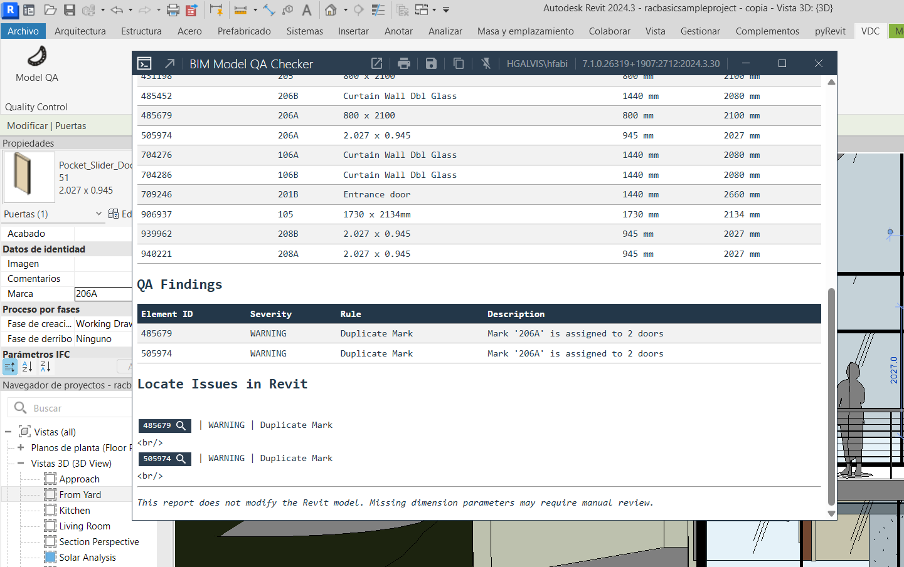

# BIM Automation Portfolio

### Python | Autodesk Revit API | pyRevit | Digital Construction

A collection of practical BIM automation projects focused on improving model data quality, reducing repetitive tasks, and connecting Building Information Modeling (BIM) with software development and data-driven construction workflows.

This portfolio documents my development of automation tools using Python, the Autodesk Revit API, and pyRevit.

**Focus Areas:** BIM Automation · VDC · AEC Technology · Data Analytics · Construction Technology

---

## Projects

### 01 — BIM Model QA Checker

**Status: Functional prototype — Tested in Revit 2024**

A custom pyRevit tool that analyzes door elements, extracts BIM parameters, identifies data quality issues, and generates an interactive quality assurance report.



**Key Features**
- Automated collection of door instances using `FilteredElementCollector`.
- Extraction of instance and type parameters.
- Automatic conversion of dimensional values to millimeters.
- Detection of missing Marks, duplicate Marks, missing dimensions, and invalid dimensions.
- Interactive QA reports with element navigation links.
- Read-only model analysis.

**Technologies:** Python, IronPython, pyRevit, Autodesk Revit API

**Verified Results**
- 16 door instances analyzed in an Autodesk sample model.
- 5 distinct door types identified.
- Missing Mark detection tested through controlled model changes.
- Duplicate Mark detection verified using two door instances sharing Mark `206A`.

[View Project Documentation](01-bim-model-qa/README.md) | [Explore Source Code](01-bim-model-qa/src/VDCTools.extension/VDC.tab/Quality%20Control.panel/Model%20QA.pushbutton/script.py)

---

### 02 — Batch Parameter Editor

**Status: Planned**

A Revit automation tool designed to modify instance parameters across multiple selected elements through controlled API transactions.

**Planned Features**
- Multi-element selection.
- Parameter validation.
- Batch parameter updates.
- Revit API transaction handling.
- Operation summaries and error reporting.

**Technologies:** Python, pyRevit, Autodesk Revit API

---

### 03 — BIM Quantity Extractor

**Status: Planned**

A BIM data extraction tool designed to collect model quantities, group elements by family and type, and prepare structured datasets for external analysis.

**Planned Features**
- Model quantity extraction.
- Element grouping and aggregation.
- Structured data export.
- CSV reporting for Excel and Power BI workflows.

**Technologies:** Python, Revit API, CSV, Data Analytics

---

## Technology Stack

| Technology | Application |
|---|---|
| Python | Automation logic and data processing |
| Autodesk Revit API | Accessing and modifying BIM model data |
| pyRevit | Custom Revit extensions and user interfaces |
| IronPython | Python execution within the configured pyRevit environment |
| Autodesk Revit 2024 | BIM development and testing |
| Visual Studio Code | Code development |
| Git & GitHub | Version control and project documentation |

## Development Approach

Each project follows a structured development workflow:

1. **Problem Identification** — Define a practical BIM or construction workflow problem.
2. **API Exploration** — Identify the relevant Revit elements, classes, and parameters.
3. **Development** — Implement Python automation using reusable functions.
4. **Validation** — Test functionality against sample BIM models.
5. **Documentation** — Record the implementation, results, limitations, and future improvements.

The objective is to develop tools that solve practical problems while demonstrating an understanding of the underlying BIM data structures and software engineering concepts.

## Repository Structure

```text
BIM_AUTOMATION_PORTFOLIO/
|
|-- 01-bim-model-qa/
|   |-- src/
|   |-- screenshots/
|   |-- sample-model/
|   |-- README.md
|
|-- README.md
|-- .gitignore
```

Projects 02 and 03 will be added as development progresses.

Revit project files and local development artifacts are excluded from version control.

## Professional Interests

My interests lie at the intersection of civil engineering, construction operations, programming, and data analytics.

I am particularly interested in applying automation and digital technologies to improve BIM coordination, construction productivity, information management, and decision-making in the Architecture, Engineering, and Construction (AEC) industry.

This portfolio represents practical, hands-on learning and the progressive development of technical skills in BIM automation and VDC.

## References

- [Autodesk Revit API Documentation](https://www.revitapidocs.com/2024/)
- [Autodesk Revit API Developer Guide](https://help.autodesk.com/cloudhelp/2024/ENU/Revit-API/files/Revit_API_Developers_Guide/Revit_API_Revit_API_Developers_Guide_html.html)
- [pyRevit Documentation](https://docs.pyrevitlabs.io/)
- [pyRevit GitHub Repository](https://github.com/pyrevitlabs/pyRevit)

---

**BIM Automation Portfolio**

*From construction experience to practical digital solutions.*
